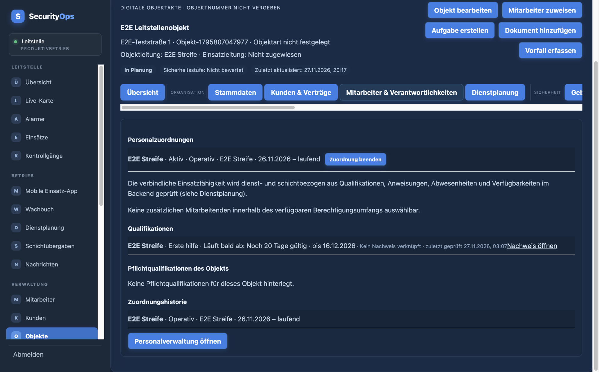

# Abschlussbericht – Qualifikations- und Nachweisverwaltung

Datum: 2026-11-27 · Branch: `fix/qualification-qa-hardening` · Basis: `origin/master` `cdc7f32` (PR #65, gemergt 2026-11-27T21:06:40Z)

## 1. Ziel und Umfang

Umfassende Prüfung und Härtung des bestehenden Qualifikationsmoduls unter Beibehaltung der Architektur. `employee_qualifications` bleibt die einzige Datenquelle; es gibt keine Attrappen, keine parallele Mitarbeiterqualifikationsstruktur und keinen DB-Freigabestatus für DMS-Dokumente. Die Freigabe läuft ausschließlich über den bestehenden DMS-Workflow; Virenprüfung, Quarantäne, Versionierung und Zugriffsschutz wurden nicht umgangen. Bestehende Produktionsdaten wurden nicht gelöscht oder verändert; alle Schreibzugriffe der Verifikation liefen gegen den isolierten E2E-Fixture-Tenant. `iptv-android/` blieb unangetastet.

## 2. Umgesetzte Fachfunktionen

- **Zentrale Übersicht:** echte KPIs, Volltextsuche, Filter nach Mitarbeiter, Objekt, Katalog, Code, Kategorie, Status, Zeitraum und Nachweis, Sortierung, serverseitige Pagination inkl. `X-Total-Count`/`X-Page-Count`, CSV-Export mit Audit und Filterprotokoll.
- **Katalog:** eindeutige Codes, acht Kategorien, Standardgültigkeit, Pflichtkennzeichnung, Dokumententyp/-liste, aktiv/inaktiv, Suche, Detail, Bearbeiten und lückenlose Audit-Historie.
- **Zuordnungen:** ausstellende Stelle, Ausstellungsdatum, gültig ab/bis, Dokumentverknüpfung, Bemerkungen, zwingender Änderungsgrund, Widerruf und revisionsfähige Entfernung (Status `invalid`, kein physisches Löschen), Neuzertifizierung als neuer Datensatz bei erhaltener Historie.
- **Gültigkeits-Herkunft (Tri-State):** explizites Datum → `manual`, `null` → `unlimited`, ausgelassen → `catalog_default` aus `default_validity_days` bei gesetztem `valid_from`. Die Herkunft wird in Übersicht, Detail und Mitarbeiterprofil deutsch labelt.
- **DMS:** Nachweise werden ausschließlich über den bestehenden DMS-Workflow geprüft und freigegeben. Download und Preview nutzen ausschließlich eine konkrete `lifecycle_state='available'`-Version mit identischen Zugriffs-, Freigabe- und Integritätsprüfungen; `latest` wird mit `400` abgewiesen. Der Download liefert `attachment`, der Preview `inline`.
- **Statusdomäne:** `Gültig`, `Läuft bald ab`, `Abgelaufen`, `Noch nicht gültig`, `Widerrufen`, `Ungültig`, `Nachweis fehlt`, `Prüfung ausstehend`. SQL und TypeScript nutzen denselben Europe/Berlin-Kalendertag; malformed Daten werden als `invalid`/`invalid_date` markiert.
- **Objektbezug:** Qualifikationsanforderungen je Objekt mit Verantwortlichem, Pflicht-/Aktivkennzeichnung, dienstplanerischer Einsatzprüfung über `staffing-eligibility` und Objektabdeckung in der Analytik.
- **Erinnerungen:** konfigurierbare Vorläufe (1–3650 Tage, bis zu 8 Termine; u. a. 180/90/60/30/14/7/1), Ablauf-/Fehlernachrichten, Dedup über `qualification_reminder_state` und Empfängergruppen aus Mitarbeiter, Objektteam sowie Admin/Operator-Subscriptions.
- **RBAC/Audit:** getrennte Rechte für Lesen, Schreiben, Katalog, Widerruf, Export, Dokumente, Erinnerungen und standortbezogene Anforderungen; Mandantentrennung per `FORCE ROW LEVEL SECURITY`/`tenant_isolation`; Audit mit Benutzer, Zeitpunkt, Mitarbeiter, Qualifikation, alt/neu und Grund.

## 3. Fehler gefunden und behoben

### 3.1 Bereits mit PR #65 behoben

1. **Overview/Analytics/Export lieferten 500:** Die Abfrage nutzte die nicht existente Spalte `e.personnel_number`; korrekt ist `e.employee_number AS personnel_number`.
2. **Zuordnungscodes kollidierten:** Ein explizit übergebener `code` wurde still ignoriert und durch `catalog.code` ersetzt. Der Code wird jetzt gegen den gewählten Katalog validiert (400 bei Abweichung) und eindeutig verwendet.
3. **CSV-Datum einen Tag verschoben:** `Date.toISOString()` erzeugte bei UTC-Mitternacht ein Datum des Vortags im Berliner Kalender. `asIso()` behält reine `YYYY-MM-DD`-Werte und formatiert `Date`-Werte in Europe/Berlin.
4. **SQL-/JS-Status driften auseinander:** Nachweise außerhalb ihres Dokumentgültigkeitsfensters wurden nicht als abgelaufen klassifiziert. Entsprechender `expired`-Zweig ergänzt.
5. **Routenkollision:** Ein generischer Detailpfad `/qualifications/:id` hätte `/qualifications/reminders` verschluckt. Umbenennung in `/qualifications/assignments/:id` und `/qualifications/assignments/:id/document`.
6. **Standortbezogene Anforderungen waren zu streng:** `siteRead`/`siteWrite` erlauben jetzt die passenden Scopes und nutzen `createSitePermissionReader` für die Objektberechtigung.
7. **Suche/PATCH-Fehler:** Freitextsuche nutzt kleingeschriebene `%term%`-Parameter; PATCH setzt `code=$12` statt der ungültigen Referenz `code=catalog.code`.
8. **E2E-Admin fehlte:** Der Operator besitzt bewusst nicht `account_security:manage`. Statt RBAC zu schwächen, stellt der isolierte Fixture-Tenant einen Admin mit deaktivierter MFA-Policy bereit.
9. **Wirkungsloser Platzhalter entfernt:** Eine nie zutreffende `isConflictErrorBody()`-Prüfung wurde aus dem Katalog-Create-Pfad entfernt.
10. **Lokale DMS-Testumgebung:** ClamAV war nur im Compose-Netzwerk erreichbar; für den Upload-Test wurde der Hostport 3310 über eine temporäre Override-Datei außerhalb des Repos veröffentlicht.
11. **CI-Docker-Build rot:** `frontend/tests/qualifications.test.tsx` nutzte `Array.prototype.at()` bei Frontend-`ES2020`. Beide Stellen wurden auf Indexzugriffe umgestellt; `docker compose build frontend` ist grün.

### 3.2 Im Härtungsbranch zusätzlich gefunden und behoben

12. **Nachweisdownload war dauerhaft kaputt:** `/api/v1/qualifications/assignments/:id/document` lieferte `/api/v1/dms/documents/:id/versions/latest/download`. Die DMS-Route kennt nur konkrete `:versionId`; `latest` führte zu `22P02`/500. Jetzt wird die konkrete `available`-Version aus dem Statusjoin geliefert; `download_url`, `preview_url` und `version_id` sind konsistent.
13. **Berechtigungs-Mismatch beim Nachweiszugriff:** Die UI gateete „Nachweis öffnen" nur auf `qualifications:documents:read`, das Backend verlangt `qualifications:documents:download` und zusätzlich `dms:read`. UI und API sind jetzt auf dieselben Rechte und denselben Site-/Owner-Scope abgestimmt.
14. **Neuzertifizierung nach Widerruf unmöglich:** Der alte Unique-Constraint auf `(tenant_id, employee_id, code)` ließ nach einem Widerruf keine neue Zertifizierung zu (409). Migration `065` entfernt ihn, ergänzt `valid_until_source`, einen Check-, einen Historie- und einen Partial Unique Index (nur eine *aktuelle* Zuordnung pro Mitarbeiter/Code). Widerrufene Datensätze bleiben als Historie erhalten.
15. **Tri-State-Verlust beim Speichern:** Ein leeres `valid_until` wurde als `null` (`unlimited`) gesendet und damit eine Katalogstandardgültigkeit versehentlich aufgehoben. Frontend und API unterscheiden jetzt `manual`, `catalog_default` und `unlimited`; PATCH mergt die Datumsprüfung mit dem bestehenden Wert.
16. **Analytik zählte widerrufene Datensätze als „Nachweis fehlt":** Im isolierten Tenant standen 27 fehlende Nachweise, obwohl die betroffenen Zuordnungen widerrufen waren. Die KPI- und Filterlogik nutzt jetzt dieselbe Statusdomäne; der Ist-Wert liegt bei 0.
17. **DMS-Auswahl war eine Raw-UUID-Eingabe:** Die Formulare verlangten eine undocumented UUID. Jetzt steht eine DMS-Auswahl mit Titel, Typ, Freigabe, Gültigkeit und Fassungsstatus zur Verfügung; Lösen der Verknüpfung über `document_id: null`, Upload-Link nur über `/dms`.
18. **Fehlende Vorschau und Filter im DMS:** `/api/v1/dms/documents` akzeptiert jetzt einen validierten `employee_id`-Filter; der neue Preview-Endpunkt teilt exakt die Download-Prüfungen. `latest` wird mit `400` abgewiesen; Audio/Video-`Content-Type` ist per Test abgesichert.
19. **Statuslogik nicht überall zentral:** `CURRENT_DATE`, UTC-`today()` und uneinheitliche Nachweiswerte führten zu Tagesverschiebungen und falschen Statusarten. `qualificationLocalDate()`/`qualificationDayNumber()` und `evidenceStatusOf()` werden jetzt von Übersicht, Dashboard, Objektakte, Phase-5, Erinnerungen, Dienstplanung und Staffing gemeinsam genutzt; ungültige Daten fallen nicht auf „heute" zurück.
20. **Dienstplanung ignorierte Nachweis- und Schichtgrenzen:** Nachweisstatus/Lifecycle/Gültigkeit werden gegen den lokalen Schichttag geprüft, Nachtschichten gegen den Starttag, Verfügbarkeitsfenster über Mitternacht; neue Reason-Codes `qualification_not_yet_valid`, `qualification_evidence_missing`, `qualification_evidence_unapproved`.
21. **Quarantäne konnte gültige Fassung verdecken:** Mehrere Status-Joins nahmen die neueste Version ohne `lifecycle_state='available'`. In `employees.ts`, `phase5.ts`, `staffing.ts` und `object-management.ts` werden jetzt nur noch verfügbare Fassungen betrachtet.
22. **Pflicht-Dokumenttypen als UND statt ODER:** `required_document_type` und `required_documents` wurden gleichzeitig auf denselben Dokumenttyp angewendet, sodass ein gültiger Nachweis abgelehnt wurde (im E2E-Lauf sichtbar). Jetzt gilt eine ODER-Auswahl; die Kombination ist per Unit- und E2E-Test abgesichert.
23. **Eingaben nicht validiert / DB-Fehler unübersetzt:** UUID-, Datums- und Integer-Parameter werden mit 400 statt 500 abgewiesen; `statusExpression()` und `availableVersionSql()` sind parametrisiert; DB-Fehler werden über `mapDatabaseError` in deutsche Meldungen übersetzt.
24. **Objektanforderungen mit falschen Rechten und unvollständigem Audit:** POST verlangte `qualifications:read` statt `qualifications:write`, erzwingt jetzt einen aktuell zugeordneten verantwortlichen Mitarbeiter, lehnt leere `notes` ab und schreibt vollständige alt/neu-Diffs. DELETE validiert die UUID.
25. **Deaktivierung ohne Begründung:** Die Objektanforderung konnte ohne Audit-Grund deaktiviert werden; die Oberfläche übergibt jetzt eine Begründung (mindestens 3 Zeichen).
26. **Analytics-Ladezustand blieb hängen:** Ein fehlgeschlagener Analytics-Aufruf zeigte dauerhaft „wird geladen". Es gibt jetzt einen Fehlerzustand mit Retry; die Objektabdeckung wird gerendert.
27. **OpenAPI unvollständig:** Preview-Pfad, Download-/Dokumentfilter-Parameter und `latest`-Hinweis wurden nachgezogen.
28. **Fixture/Test-Infrastruktur nach Migration 065:** Der E2E-Fixture nutzte den entfernten Unique-Constraint als `ON CONFLICT`-Ziel (`42P10`); er wurde auf die stabile Fixture-ID umgestellt und setzt `valid_until_source='manual'`. Der DB-Integrationstest nutzte denselben Code für zwei Mandanten und kollidierte mit dem neuen Partial Index; er verwendet jetzt getrennte Codes.

## 4. Dateien geändert

| Datei | Zweck |
|---|---|
| `backend/src/routes/qualifications.ts` | Katalog-, Zuordnungs-, Übersichts-, Export-, Analytics-, Objektanforderungs-, Reminder-, Download- und Validierungslogik; DB-Fehlermapping; ODER-Regel für Dokumenttypen |
| `backend/src/routes/dms.ts` | Gemeinsame Lese-/Prüfroutine für Download und Preview, `employee_id`-Filter, `latest` → 400 |
| `backend/src/services/qualification-status.ts` | Zentrale Statusdomäne, Berlin-Tagesindex, ungültige Daten, Nachweisbewertung |
| `backend/src/services/dms-document-status.ts` | Gemeinsamer Berlin-Tag und akzeptierte Nachweiswerte |
| `backend/src/services/staffing-eligibility.ts`, `backend/src/routes/staffing.ts` | Nachweisgültigkeit, Schichttag, Nachtschichten, Availability-Fenster, Reason-Codes |
| `backend/src/routes/employees.ts`, `object-management.ts`, `phase5.ts` | Berlin-Tag statt `CURRENT_DATE`, Statusdomäne, Available-Version-Joins, Objektabdeckung |
| `backend/src/services/qualification-reminders.ts`, `backend/src/services/notifications.ts` | Erinnerungsworker, Empfängergruppen, Betreffeld |
| `backend/src/openapi.ts` | Preview-Pfad, Download-/Dokumentfilter-Parameter, `latest`-Hinweis |
| `backend/src/e2e-fixture.ts` | Additive Migration 065, `ON CONFLICT (id)`, `valid_until_source` |
| `backend/migrations/063_qualification_management_completion.sql`, `064_qualification_reminder_history.sql` | Additives Schema, RLS, FKs, Permissions, Reminder-Historie und Subscriptions (unverändert) |
| `backend/migrations/065_qualification_recertification_history.sql` | Neu: Entfernung des alten Unique-Constraints, `valid_until_source` + Check, Historie- und Partial Unique Index |
| `backend/tests/qualification-routes.test.ts` | 33 Tests: Tri-State, Herkunft, Recertification, Historie, Filtervalidierung, Download-URL, ODER-Dokumenttyp |
| `backend/tests/qualification-recertification.integration.test.ts` | Neu: DB-Integrationstest für Partial Unique Index, Historie und Mandantentrennung |
| `backend/tests/qualification-status.test.ts`, `staffing-eligibility.test.ts`, `staffing.test.ts`, `object-management.test.ts`, `phase5.test.ts`, `dms-approval.test.ts`, `dms-upload.test.ts`, `tenant-isolation-routes.test.ts`, `dms-document-status-berlin.test.ts`, `employee-dashboard-qualification.test.ts` | Erweiterte Absicherung der Status-, DMS-, RBAC- und Dienstplanlogik |
| `frontend/src/pages/Qualifications.tsx`, `EmployeeDetail.tsx`, `Sites.tsx`, `frontend/src/lib/status.ts` | DMS-Auswahl, Tri-State-Formulare, Herkunftslabels, Vorschau, Download/Preview, Analytics-Fehler/Retry, Objektabdeckung, Begründungen, Eligibility-Labels |
| `frontend/tests/qualifications.test.tsx`, `form-contracts.test.tsx` | Frontend-Verträge und Tri-State-Erwartungen |
| `e2e/qualification-management.spec.ts` | 13 Szenarien inkl. konkreter Download-/Preview-URLs, echtem Download, Tri-State, Recertification/Historie und Filtervalidierung |
| `docs/QA/screenshots/qualifications-*.png` | Vier echte Browser-Screenshots |
| `docs/QA/QUALIFIKATIONSVERWALTUNG-ABSCHLUSSBERICHT.md` | Dieser Bericht |

`iptv-android/` ist untracked und wurde nicht angefasst.

## 5. Migrationen

Die Migrationen `063` und `064` sind additiv und lokal angewendet; ihre Checksums wurden nach dem Anwenden nicht mehr verändert. `065_qualification_recertification_history.sql` ist die nächste freie, ebenfalls additive Migration und wurde gegen eine frische Testdatenbank (`securityops_qa_test`) und die lokale E2E-Datenbank angewendet (`Applied 65 migration(s)` bzw. `Applied 1 migration(s)`). Sie entfernt den alten Unique-Constraint, ergänzt `valid_until_source` mit Check, einen Historie-Index und einen Partial Unique Index für genau eine aktuelle Zuordnung pro Mitarbeiter/Katalogcode. Bestehende Zeilen blieben erhalten. Der Runner verlangt weiterhin lückenlose Versionen; der Checksum ist der SHA-256 der gesamten SQL-Datei.

## 6. Verifikation – tatsächliche Ergebnisse

### 6.1 Erfolgreich getestet

- `npm run lint`: **grün**, keine ESLint-Meldungen.
- `npm run typecheck` (Backend + Frontend): **grün**.
- `npm test -w backend -- --runInBand --silent`: **56 Suites / 514 Tests grün**, 8 Suites / 39 Tests bewusst übersprungen (ohne `POSTGRES_TEST_DATABASE_URL`).
- `POSTGRES_TEST_DATABASE_URL=… npm test -w backend -- --runInBand --silent` gegen frisch migrierte `securityops_qa_test`: **64 Suites / 553 Tests grün**, 0 Fehler, 0 übersprungen — inklusive des neuen DB-Integrationstests.
- `npm test -w frontend -- --silent`: **14 Dateien / 168 Tests grün** (Vitest akzeptiert kein `--runInBand`; jsdom gibt drei nicht-failende `Not implemented: navigation`-Warnungen aus).
- `npm run build`: **grün**; einzige Meldung ist die bestehende Vite-Warnung zu Chunks > 500 kB.
- `npm run migrate -w backend`: **grün**, 65 Migrationen auf leerer Testdatenbank, 1 Migration auf lokaler E2E-Datenbank.
- `npx playwright test e2e/qualification-management.spec.ts --workers=1`: **13/13 Szenarien grün**.
- Browserabnahme als Admin `e2e-qm-admin@example.invalid` gegen `localhost:5173`: Übersicht, Kennzahlen, Mitarbeiterprofil, Nachweisdownload/-vorschau und Objektakte ohne Konsolenfehler; alle `/api/v1/qualifications*`-Requests `200`.
  - Kennzahlen vor der Korrektur: `total 29, valid 0, expiring 1, expired 0, invalid_revoked 28, missing_evidence 27`; nach der Korrektur: `total 56, valid 0, expiring 1, expired 0, invalid_revoked 55, missing_evidence 0`.
  - Download-Endpunkt liefert `download_url`/`preview_url` mit konkreter Version; Download `200 text/plain` mit `attachment`, Preview `200` mit `inline`, `versions/latest/download` → `400 {"error":"Ungültige Dokument- oder Versions-ID"}`.
  - Herkunftslabel „Manuell festgelegt" in der Mitarbeiterqualifikationstabelle sichtbar; DMS-Auswahl im Zuordnungsformular vorhanden.
  - `/api/v1/sites/.../object-context` → `200` mit `personnelSummary`, abweichenden Statusarten und Nachweislabels.
  - Konsole: keine Fehlermeldungen; nur der bekannte React-DevTools-Hinweis und ein WebSocket-Hinweis der Live-Karte.

### 6.2 Teilweise getestet

- **Objektabdeckung:** Rendering und Analytics-Endpunkt sind implementiert und liefern `200`; im isolierten Tenant ist die Tabelle leer, weil die E2E-Anforderung am Ende des Laufs deaktiviert wird. Die Anzeige mit befüllten Werten wurde nicht in einem eigens dafür angelegten Datenbestand browserverifiziert.
- **Neuzertifizierung/Historie im Browser:** über E2E-Szenario 11 und den DB-Integrationstest verifiziert; nicht separat per Maus im Browser nachgestellt.
- **DMS-Auswahl und -Verknüpfung im Browser:** über Frontend-Tests, E2E und API geprüft; die manuelle Auswahl im Browser wurde nicht erneut geklickt.
- **Audio/Video-Preview im Browser:** `Content-Type` und `inline`-Disposition sind per Test abgesichert; ein echtes Abspielen im Browser wurde nicht durchgeführt.
- **Andere Browser/Mobilgeräte und Lasttests:** nicht Gegenstand dieser Abnahme.

### 6.3 Nicht getestet

- Produktionsdatenbank und Produktivumgebung (ausschließlich isolierte Test-/E2E-Tenants verwendet).
- Echte Produktions-DMS-Freigaben mit Virenprüfung gegen produktive ClamAV-/Speicherdienste.
- Mandantentrennung im Browser (nur per E2E-Szenario 12 und API-Test geprüft).
- migrationsbasierte Reorganisation sehr großer Bestandsdatenmengen (nur leere/frische Testdatenbank).

### 6.4 E2E-Abdeckung

| # | Szenario | Ergebnis |
|---:|---|---|
| 1 | Login und Navigation zu Qualifikationen | grün |
| 2 | Katalogeintrag mit eindeutigem Code und Pflichtbegründung | grün |
| 3 | Duplicate-Code → 409 und deutsche Fehlermeldung | grün |
| 4 | Katalog bearbeiten und deaktivieren inkl. Audit | grün |
| 5 | Zuweisung mit Standardgültigkeit und `catalog_default` | grün |
| 6 | Dokument verknüpfen: Prüfung ausstehend bis DMS-Freigabe, konkrete Download-/Preview-URL, echter Download, `employee_id`-Filter | grün |
| 7 | Suche, Statusfilter, Sortierung und Pagination | grün |
| 8 | CSV-Export der Übersicht | grün |
| 9 | Detailansicht und Historie einer Zuordnung | grün |
| 10 | Bearbeiten mit Begründung und alt/neu im Audit | grün |
| 11 | Widerruf, Entfernen und Neuzertifizierung als neuer Datensatz bei erhaltener Historie | grün |
| 12 | Objektanforderung, Einsatzprüfung, Erinnerungen, RBAC, Mandantentrennung | grün |
| 13 | Gültigkeits-Herkunft, Tri-State, PATCH ohne Datum, Filtervalidierung (400) | grün |

### 6.5 Screenshots

## 7. API- und Berechtigungsänderungen

- `GET /api/v1/qualifications/assignments/:id/document` liefert nun `document_id`, konkrete `version_id`, `download_url` und `preview_url` statt einer `latest`-URL.
- Neu: `GET /api/v1/dms/documents/:documentId/versions/:versionId/preview` mit identischen Prüfungen wie der Download, `inline`-Disposition.
- `GET /api/v1/dms/documents` akzeptiert optional `employee_id` (UUID, sonst 400).
- `GET/POST /api/v1/sites/:id/qualification-requirements` verlangt `qualifications:write` statt `qualifications:read`; POST verlangt einen aktuell zugeordneten Verantwortlichen und nicht-leere `notes`, DELETE eine gültige UUID.
- Nachweiszugriff verlangt `qualifications:documents:download` **und** `dms:read` im Site-/Owner-Scope; die UI-Gates wurden entsprechend angepasst. Keine Rechteerweiterung für den Operator.
- Neue Antwortfelder: `valid_until_source` (`manual`, `catalog_default`, `unlimited`; `NULL` = Legacy/unbekannt), `site_coverage` in der Analytik, neue Eligibility-Reason-Codes.
- Alle neuen Pfade und Parameter sind in `backend/src/openapi.ts` dokumentiert.

## 8. Zwischenergebnisse der Verifikation

- Der erste E2E-Lauf nach der Fixture-Erweiterung scheiterte mit `42P10`, weil Migration 065 den `ON CONFLICT (tenant_id, employee_id, code)`-Zielindex entfernt hatte; die Fixture wurde auf `ON CONFLICT (id)` umgestellt.
- Der DB-Integrationstest scheiterte zunächst an einem doppelten Code über zwei Mandanten hinweg (Partial Unique Index); er nutzt jetzt getrennte Codes pro Mandant.
- Ein E2E-Lauf deckte die fälschliche UND-Beziehung der Pflicht-Dokumenttypen auf (`409` trotz freigegebener Fassung); die ODER-Regel wurde im Backend und in der E2E-Fixture korrigiert. Danach: 13/13 grün.
- Ein vollständiger Backend-Lauf mit Testdatenbank-URL schlug zunächst mit genau diesem Integrationsfehlschlag fehl; nach der Korrektur und dem ODER-Test: 64/64 Suites, 553/553 Tests grün.

## 9. Umgebungsbesonderheiten / offene Punkte

- Für den lokalen E2E-Lauf wurden `LOGIN_RATE_LIMIT_MAX=400` und `API_RATE_LIMIT_MAX=2000` verwendet. Die Produktionskonfiguration blieb unverändert.
- Der ClamAV-Hostport 3310 wurde nur temporär über `/tmp/qm-clamav-override.yml` veröffentlicht; `docker-compose.yml` blieb unverändert.
- Der Vite-Build meldet weiterhin nur die generelle Chunk-Größenwarnung; kein funktionaler Fehler.
- jsdom meldet drei nicht-failende `Not implemented: navigation`-Warnungen durch `<a>`-Klicks in Frontend-Tests.
- Der Browser zeigt einen WebSocket-Hinweis der Live-Karte (`WebSocket is closed before the connection is established`) und den React-DevTools-Hinweis; beide sind bekannt und stehen nicht im Zusammenhang mit dem Qualifikationsmodul.
- Nach Abschluss der E2E-Suite wurden die Fixture-Zuordnungen revisionsfähig auf `invalid` gesetzt und die Kataloge deaktiviert; die Audit-Einträge bleiben erhalten. Deshalb erscheinen im isolierten Tenant 55 ungültige/widerrufene Datensätze — erwartetes Artefakt der wiederholten Testläufe, keine Produktionsdaten.
- Die lokale Testdatenbank `securityops_qa_test` wurde ausschließlich für die Migration-065-/ Integrationsprüfung angelegt und ist kein Produktivsystem.
