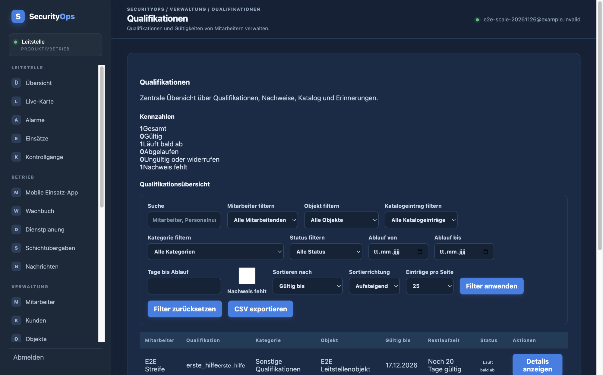
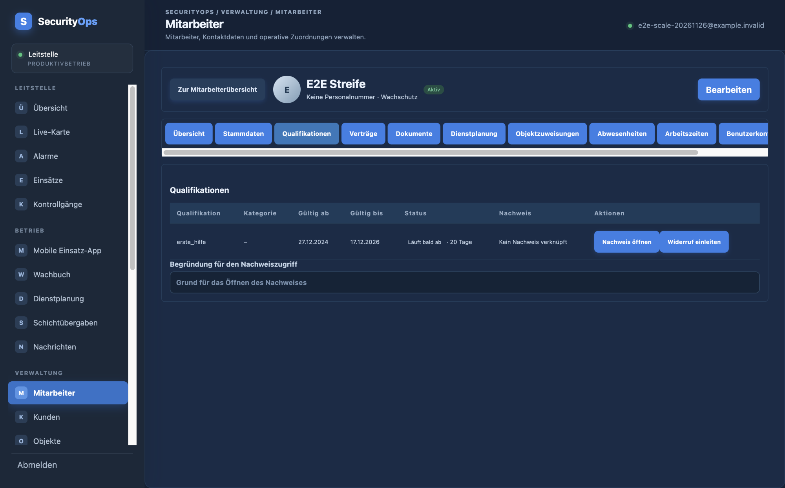

# Abschlussbericht – Qualifikations- und Nachweisverwaltung

Datum: 2026-11-27 · Branch: `feature/qualification-management` · Basis: `7d988cf` (`origin/master`, inkl. PR #64)

## 1. Ziel und Umfang

Vollständige Analyse, Überarbeitung und Umsetzung einer zentralen, revisionsfähigen Qualifikationsverwaltung. `employee_qualifications` bleibt die einzige Datenquelle; es gibt keine parallele Mitarbeiterqualifikationsstruktur und keinen DB-Freigabestatus für DMS-Dokumente. Bestehende Produktionsdaten wurden nicht gelöscht oder verändert; alle Schreibzugriffe der Verifikation liefen gegen den isolierten E2E-Fixture-Tenant.

## 2. Umgesetzte Fachfunktionen

- **Zentrale Übersicht:** echte KPIs, Volltextsuche, Filter nach Mitarbeiter, Objekt, Katalog, Code, Kategorie, Status, Zeitraum und Nachweis, Sortierung, serverseitige Pagination inkl. `X-Total-Count`/`X-Page-Count` sowie CSV-Export mit Audit.
- **Katalog:** eindeutige Codes, acht Kategorien, Standardgültigkeit, Pflichtkennzeichnung, Dokumententyp/-liste, aktiv/inaktiv, Suche, Detail, Bearbeiten und lückenlose Audit-Historie.
- **Zuordnungen:** ausstellende Stelle, Ausstellungsdatum, gültig ab/bis, Dokumentverknüpfung, Bemerkungen, zwingender Änderungsgrund, Widerruf und revisionsfähige Entfernung (Status `invalid`, kein physisches Löschen), Duplikatschutz pro Mitarbeiter/Code.
- **DMS:** Nachweise werden ausschließlich über den bestehenden DMS-Workflow geprüft und freigegeben. Ein hochgeladenes Dokument bleibt solange `Prüfung ausstehend`, bis die DMS-Freigabe vorliegt; der Download ist erst nach Freigabe erlaubt.
- **Statusdomäne:** `Gültig`, `Läuft bald ab`, `Abgelaufen`, `Noch nicht gültig`, `Widerrufen`, `Ungültig`, `Nachweis fehlt`, `Prüfung ausstehend`. SQL und TypeScript nutzen denselben Europe/Berlin-Kalendertag.
- **Objektbezug:** Qualifikationsanforderungen je Objekt mit Verantwortlichem, Pflicht-/Aktivkennzeichnung und dienstplanerischer Einsatzprüfung über `staffing-eligibility`.
- **Erinnerungen:** konfigurierbare Vorläufe (1–3650 Tage, bis zu 8 Termine; damit u. a. 180/90/60/30/14/7/1), Ablauf-/Fehlernachrichten, Dedup über `qualification_reminder_state` und Empfängergruppen aus Mitarbeiter, Objektteam sowie Admin/Operator-Subscriptions.
- **RBAC/Audit:** getrennte Rechte für Lesen, Schreiben, Katalog, Widerruf, Export, Dokumente, Erinnerungen und standortbezogene Anforderungen; Mandantentrennung per `FORCE ROW LEVEL SECURITY`/`tenant_isolation`; Audit mit Benutzer, Zeitpunkt, Mitarbeiter, Qualifikation, alt/neu und Grund.

## 3. Fehler gefunden und behoben

1. **Overview/Analytics/Export lieferten 500:** Die Abfrage nutzte die nicht existente Spalte `e.personnel_number`; korrekt ist `e.employee_number AS personnel_number`.
2. **Zuordnungscodes kollidierten:** Ein explizit übergebener `code` wurde still ignoriert und durch `catalog.code` ersetzt. Mehrere Zuordnungen desselben Katalogs landeten in derselben Zeile. Der Code wird jetzt gegen den gewählten Katalog validiert (400 bei Abweichung) und eindeutig verwendet.
3. **CSV-Datum einen Tag verschoben:** `Date.toISOString()` erzeugte bei UTC-Mitternacht ein Datum des Vortags im Berliner Kalender. `asIso()` behält reine `YYYY-MM-DD`-Werte und formatiert `Date`-Werte in Europe/Berlin.
4. **SQL-/JS-Status driften auseinander:** Nachweise außerhalb ihres Dokumentgültigkeitsfensters wurden nicht als abgelaufen klassifiziert. Entsprechender `expired`-Zweig ergänzt.
5. **Routenkollision:** Ein generischer Detailpfad `/qualifications/:id` hätte `/qualifications/reminders` verschluckt. Umbenennung in `/qualifications/assignments/:id` und `/qualifications/assignments/:id/document`.
6. **Standortbezogene Anforderungen waren zu streng:** `siteRead`/`siteWrite` erlauben jetzt die passenden Scopes und nutzen `createSitePermissionReader` für die Objektberechtigung.
7. **Suche/PATCH-Fehler:** Freitextsuche nutzt kleingeschriebene `%term%`-Parameter; PATCH setzt `code=$12` statt der ungültigen Referenz `code=catalog.code`.
8. **E2E-Admin fehlte:** Der Operator besitzt bewusst nicht `account_security:manage`. Statt RBAC zu schwächen, stellt der isolierte Fixture-Tenant einen Admin mit deaktivierter MFA-Policy bereit.
9. **Wirkungsloser Platzhalter entfernt:** Eine nie zutreffende `isConflictErrorBody()`-Prüfung wurde aus dem Katalog-Create-Pfad entfernt.
10. **Lokale DMS-Testumgebung:** ClamAV war nur im Compose-Netzwerk erreichbar; für den Upload-Test wurde der Hostport 3310 über eine temporäre Override-Datei außerhalb des Repos veröffentlicht.

## 4. Dateien geändert

| Datei | Zweck |
|---|---|
| `backend/src/routes/qualifications.ts` | Katalog-, Zuordnungs-, Übersichts-, Export-, Analytics-, Objektanforderungs-, Reminder- und Download-API |
| `backend/src/services/qualification-status.ts` | Verbindliche Statusdomäne und Berliner Tagesgrenze |
| `backend/src/services/qualification-reminders.ts` | Erinnerungsworker, Empfängergruppen, Dedup und Historie |
| `backend/src/services/staffing-eligibility.ts` | Dienstplanerische Einsatzprüfung mit Nachweisregeln |
| `backend/src/routes/employees.ts`, `phase5.ts`, `staffing.ts`, `object-management.ts` | Umstellung auf zentrale Statuslogik |
| `backend/src/services/notifications.ts`, `backend/src/openapi.ts`, `backend/src/e2e-fixture.ts` | Betrefffeld, API-Dokumentation, isolierter Fixture-Admin |
| `backend/migrations/063_qualification_management_completion.sql`, `064_qualification_reminder_history.sql` | Additives Schema, RLS, FKs, Permissions, Reminder-Historie und Subscriptions |
| `backend/tests/qualification-routes.test.ts`, `qualification-status.test.ts`, `qualification-reminders.test.ts`, `staffing-eligibility.test.ts`, `object-management.test.ts` | Backend-Absicherung inkl. der neu gefundenen Fehler |
| `frontend/src/pages/Qualifications.tsx`, `EmployeeDetail.tsx`, `Sites.tsx`, `frontend/src/lib/status.ts` | Zentralübersicht, Detaildialoge, Objektakte und Statusanzeige |
| `frontend/tests/qualifications.test.tsx` | Frontend-Testsuite |
| `e2e/qualification-management.spec.ts` | 12 E2E-Szenarien |
| `docs/QA/screenshots/qualifications-*.png` | Vier echte Browser-Screenshots |
| `docs/QA/QUALIFIKATIONSVERWALTUNG-ABSCHLUSSBERICHT.md` | Dieser Bericht |

`iptv-android/` ist untracked und wurde nicht angefasst.

## 5. Migrationen

Die Migrationen `063` und `064` sind additiv und lokal angewendet. Nach dem Anwenden wurden ihre Checksums nicht mehr verändert. Bestehende Zeilen blieben erhalten; `064` ergänzt nur Spalten, Indizes, FKs, Event-Typen und fehlende Subscriptions.

## 6. Verifikation – tatsächliche Ergebnisse

- `npm run lint`: **grün**, keine ESLint-Meldungen.
- `npm run typecheck` (Backend + Frontend): **grün**.
- `npm test -w backend -- --runInBand --silent`: **54 Suites / 487 Tests grün**, 7 Suites / 37 Tests bewusst übersprungen (524 Gesamttests).
- `npm test -w frontend`: **14 Dateien / 159 Tests grün**.
- `npm run build`: **grün**; einzige Meldung ist die bestehende Vite-Warnung zu Chunks > 500 kB.
- `npx playwright test e2e/qualification-management.spec.ts --workers=1`: **12/12 Szenarien grün** (10,4 s).
- Browser-Rundgang: Übersicht, Detaildialog, Mitarbeiterprofil und Objektakte ohne Konsolenfehler; alle `/api/v1/qualifications*`-Requests `200`.

### E2E-Abdeckung

| # | Szenario | Ergebnis |
|---:|---|---|
| 1 | Login und Navigation zu Qualifikationen | grün |
| 2 | Katalogeintrag mit eindeutigem Code und Pflichtbegründung | grün |
| 3 | Duplicate-Code → 409 und deutsche Fehlermeldung | grün |
| 4 | Katalog bearbeiten und deaktivieren inkl. Audit | grün |
| 5 | Zuweisung mit Standardgültigkeit | grün |
| 6 | Dokument verknüpfen: Prüfung ausstehend bis DMS-Freigabe | grün |
| 7 | Suche, Statusfilter, Sortierung und Pagination | grün |
| 8 | CSV-Export der Übersicht | grün |
| 9 | Detailansicht und Historie einer Zuordnung | grün |
| 10 | Bearbeiten mit Begründung und alt/neu im Audit | grün |
| 11 | Widerruf und Entfernen mit Begründung | grün |
| 12 | Objektanforderung, Einsatzprüfung, Erinnerungen, RBAC, Mandantentrennung | grün |

### Screenshots

## 7. Zwischenergebnisse der Verifikation

- Erster E2E-Lauf nach Fixture-Erweiterung: 8 Fehlschläge durch die oben genannten Code-Kollisionen, Datumsverschiebung und veraltete UI-Texte; 4 Szenarien grün.
- Ein früher Lauf scheiterte bereits vor den Tests an `403` beim Anlegen eines Admin-Kontos durch den Operator; Ursache war das fehlende `account_security:manage`, nicht die Qualifikationslogik.
- Zweiter Lauf nach den API-/UI-Korrekturen: 11/12 grün; der verbleibende Fehler war ein zu unscharfer gemeinsamer Suchbegriff im Paginationstest.
- Dritter Lauf nach Vergabe eines laufunique-Präfix für beide Vergleichscodes: 12/12 grün.

## 8. Umgebungsbesonderheiten / offene Punkte

- Für den lokalen E2E-Lauf wurden `LOGIN_RATE_LIMIT_MAX=400` und `API_RATE_LIMIT_MAX=2000` verwendet. Die Produktionskonfiguration blieb unverändert.
- Der ClamAV-Hostport 3310 wurde nur temporär über `/tmp/qm-clamav-override.yml` veröffentlicht; `docker-compose.yml` blieb unverändert.
- Der Vite-Build meldet weiterhin nur die generelle Chunk-Größenwarnung; kein funktionaler Fehler.
- Nach Abschluss der E2E-Suite wurden die Fixture-Zuordnungen revisionsfähig auf `invalid` gesetzt und die Kataloge deaktiviert; die Audit-Einträge bleiben erhalten.
